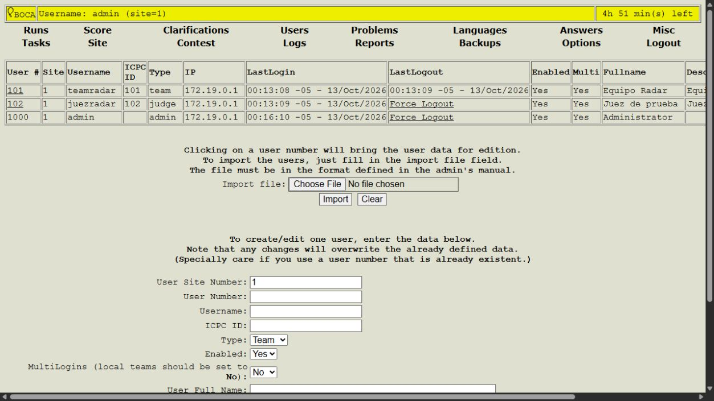
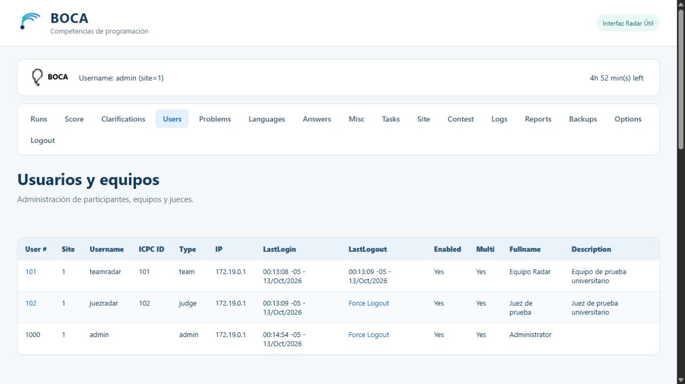
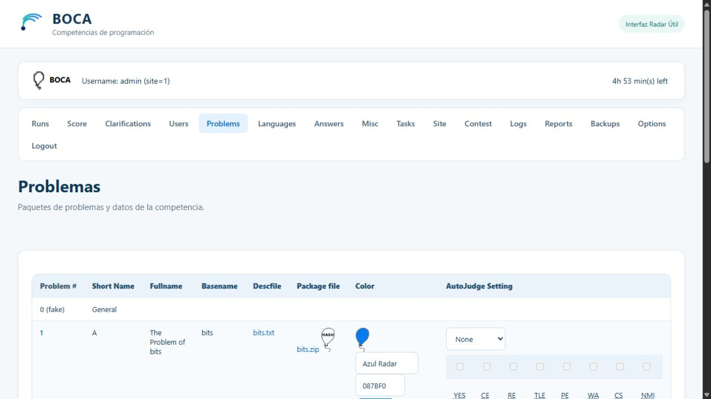
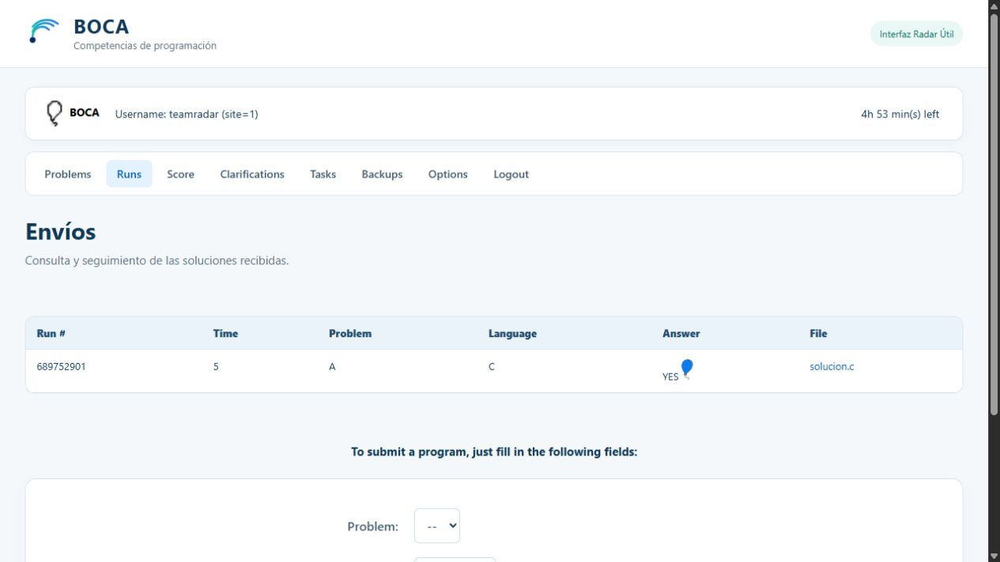

# Apartados 15 a 18 de la entrega final

## 15. ARCHIVOS QUE COMPONEN LA ENTREGA FINAL

La entrega final incluye el código original de BOCA, los recursos Front-end desarrollados, los archivos adaptados y la configuración necesaria para construir y ejecutar la aplicación. También conserva el proyecto Radar Útil de las entregas anteriores y su historial en Git.

La integración utiliza **BOCA 1.5.24**, obtenido del repositorio oficial `cassiopc/boca`, en la revisión `5a6232c7dd4691dfc728014819c74264058891ba`. Sus **602 archivos originales** se encuentran en `integrations/boca/upstream/` y se verificaron mediante hashes SHA-256. La personalización y la configuración se organizaron por separado para distinguir lo que pertenece al software oficial de lo que fue desarrollado para esta entrega.

**Tabla 11. Estructura del proyecto con el software BOCA.**

| Tipo | Archivo o carpeta | Función |
|---|---|---|
| BOCA | `integrations/boca/upstream/src/`, especialmente `index.php` | Aplicación PHP original: acceso y páginas reales de administración, equipos y jueces. |
| BOCA | `integrations/boca/upstream/src/private/` | Configuración original de referencia e instalador de la base de datos, incluido `createdb.php`. Se conserva sin cambios; la configuración efectiva del entorno se incorpora durante la construcción. |
| BOCA | `integrations/boca/upstream/src/db.php`, `fcontest.php` y `fproblem.php`; carpetas `system/`, `admin/`, `team/` y `judge/` | Conexión y funciones internas originales, administración de competencias y problemas, y operaciones según el perfil. |
| Desarrollo Front-end | `integrations/boca/custom/radar-boca.css` | Estilos de la interfaz: colores, tipografía, espaciado, navegación, formularios, botones, tablas y adaptación a pantallas pequeñas. |
| Desarrollo Front-end | `integrations/boca/custom/radar-boca.js` | Organización visual del documento original: marca, títulos, clases, etiquetas accesibles, página activa y contenedores de desplazamiento para tablas. Conserva las acciones y eventos de BOCA. |
| Desarrollo Front-end | `integrations/boca/custom/marca-boca.svg` | Recurso gráfico adaptado de la identidad visual de Radar Útil para las páginas de BOCA. |
| Integración | `integrations/boca/modified/src/Css.php` | Copia revisable del archivo que conserva el CSS original y agrega la lectura de la hoja de estilos propia. |
| Integración | `integrations/boca/modified/src/version.php` | Copia revisable del archivo que conserva su contenido original y añade viewport y carga diferida del JavaScript propio en ejecución web. |
| Integración | `integrations/boca/docker/conf.php` y su copia `modified/src/private/conf.php` | Configuración efectiva de BOCA mediante variables de entorno, sin incorporar secretos personales a los fuentes. |
| Ejecución | `integrations/boca/Dockerfile`, `compose.yaml` y `docker/` | Construcción del servidor Ubuntu, servicios Apache/PHP y PostgreSQL, inicialización original, red interna y almacenamiento persistente. |
| Preparación | `integrations/boca/scripts/preparar.sh`, `preparar.ps1` y `aplicar-tema.php` | Generación de configuración local en Ubuntu o Windows y aplicación repetible de las mejoras de presentación. |
| Pruebas | `integrations/boca/tests/verificar.mjs` y `verificar-origen.mjs` | Comprobaciones funcionales mediante peticiones reales y validación de integridad de los originales. |
| Documentación y evidencia | `integrations/boca/README.md`, `docs/INTEGRACION_BOCA.md`, `docs/ARCHIVOS_ENTREGA.md` y `docs/evidencias-boca/` | Instrucciones reproducibles, informe técnico, manifiesto individual de archivos, capturas reales y reportes de pruebas. |

La carpeta `modified/` permite revisar los tres archivos adaptados. Durante la construcción, el entorno utiliza el código de `upstream/`, aplica los cambios de presentación mediante `aplicar-tema.php` y copia la configuración de `docker/conf.php`. Por tanto, las copias de `modified/` no deben instalarse manualmente ni confundirse con los originales.

La entrega contiene los fuentes necesarios, pero requiere descargar las imágenes Docker y los paquetes del sistema en la primera construcción. No se incluyen imágenes Docker binarias, una base precargada ni el archivo local `.env`. Los scripts incluidos generan este último. El manifiesto [ARCHIVOS_ENTREGA.md](ARCHIVOS_ENTREGA.md) identifica cada archivo y su origen.

## 16. MEJORAS REALIZADAS EN LA INTERFAZ DE BOCA

Las mejoras se aplicaron a páginas reales de BOCA para facilitar la lectura y la interacción del usuario. Se reutilizaron como referencia los colores azul y turquesa, la identidad de radar, la jerarquía de títulos y la organización visual desarrolladas previamente en Radar Útil.

La aplicación continúa ejecutando sus procesos originales de autenticación, administración, almacenamiento y evaluación. Las páginas PHP no se sustituyeron por páginas Angular. La personalización incorpora CSS y JavaScript de presentación sobre el HTML generado por BOCA, manteniendo las rutas, los nombres e identificadores técnicos de los controles y sus eventos originales.

**Tabla 12. Mejoras aplicadas a la interfaz de BOCA.**

| Página o elemento | Mejora realizada |
|---|---|
| Acceso | Tarjeta central con título e instrucciones, campos con etiquetas accesibles, espaciado y botón azul. Se conserva el formulario y el mecanismo original de hash para autenticar. |
| Navegación principal | Menú con enlaces amplios y distribución flexible, resaltado de la página actual, y panel separado para el usuario autenticado y el reloj de la competencia. |
| Competencia y sede | Títulos descriptivos, controles originales organizados en paneles, bordes y espaciado uniforme. Se mantienen las acciones de guardar y activar. |
| Usuarios, equipos y jueces | Título que identifica el contenido, tablas con filas alternas y mejor separación de columnas, formularios agrupados y desplazamiento horizontal cuando el contenido es extenso. |
| Problemas | Formulario de carga y tabla de metadatos con estilos consistentes. BOCA sigue procesando el paquete del problema y guardando sus datos. |
| Envíos y revisión | Presentación legible de estados, archivos y respuestas; controles originales de problema, lenguaje y código, y formulario de evaluación manual. |
| Resultados | Estilos aplicados a la clasificación calculada por BOCA, conservando la información y puntuación originales. |
| Formularios y botones | Tamaños, bordes y colores consistentes; separación entre campos y secciones; acciones visualmente identificables y contornos de foco. |
| Pantallas pequeñas | Marca simplificada, menú distribuido en varias líneas y tablas extensas desplazables dentro de su contenedor. Se comprobó una pantalla de 390 × 844 px. |

La comparación de firmas del formulario de usuarios antes y después de la personalización confirmó que se conservaron los nombres, tipos, identificadores, métodos, acciones y eventos evaluados. Además, se comprobaron operaciones reales después de aplicar el tema.

### Comparación de la interfaz

Las **figuras 7 y 8**, presentadas en el apartado 18, muestran la misma página de usuarios y los mismos registros de la competencia 10: primero con la presentación original y después con el tema desarrollado. Se observan los cambios de navegación, títulos, colores, espaciado y legibilidad de la tabla.

Para mantener el informe breve, estas imágenes se incluyen una sola vez. Las diferencias en horas o fechas de acceso de los usuarios corresponden al tiempo transcurrido entre las capturas.

## 17. INSTRUCCIONES PARA PONER EN FUNCIONAMIENTO LA APLICACIÓN

La aplicación se instaló y comprobó con **Docker Desktop sobre Windows**, ejecutando el servidor web en **Ubuntu 24.04.5 LTS dentro de un contenedor**. En ese servidor se verificaron Apache 2.4.58 y PHP 8.3.6. PostgreSQL 16.15 se ejecutó en otro contenedor, basado en Debian.

La guía académica propone Ubuntu y permite utilizar una máquina virtual cuando sea necesario. En esta implementación se utilizó un contenedor Ubuntu; no se realizó una instalación nativa de Ubuntu ni una prueba en VirtualBox. Esta distinción permite describir con precisión el entorno realmente comprobado.

### 17.1 Requisitos previos

Para reproducir el proyecto se requiere:

- Un equipo con acceso a Internet durante la primera construcción.
- Docker Desktop configurado para contenedores Linux en Windows, o Docker Engine y el complemento Compose en Ubuntu 24.04.
- Docker Compose con soporte para `--wait` y el servicio Docker iniciado. La versión comprobada fue Compose 5.3.0.
- Los archivos del repositorio o del paquete de entrega, incluida la carpeta `integrations/boca/`.
- Un navegador web actual.
- El puerto local 8088 disponible. El puerto 8089 solo se utiliza para la comparación opcional.
- Node.js 24 si se desean ejecutar los scripts de pruebas. No es necesario para el funcionamiento de BOCA.

Los fuentes oficiales de BOCA y los recursos Front-end están incluidos. Apache, PHP, PostgreSQL y las dependencias se instalan o descargan mediante el entorno definido en el repositorio. No es necesario instalar XAMPP ni ejecutar Angular para utilizar BOCA.

### 17.2 Instalación de BOCA

**Procedimiento comprobado en Windows.** Con Docker Desktop iniciado, desde la raíz de la carpeta `RadarUtil`, ejecutar en PowerShell:

```powershell
Set-Location integrations\boca
& .\scripts\preparar.ps1
docker compose up -d --build --wait web
docker compose ps
```

El primer comando entra en la carpeta de integración. `preparar.ps1` genera `.env` con una contraseña de PostgreSQL y una clave interna aleatorias. Si el archivo ya existe, lo conserva. `docker compose up` construye la imagen web, inicia PostgreSQL y espera que los servicios estén disponibles.

Al iniciar el contenedor web, `entrypoint.sh` espera a la base de datos y ejecuta `initialize.php`. Este comprueba si existe `bocadb`. Cuando todavía no existe, invoca el instalador original **`src/private/createdb.php`**; cuando existe, conserva la base. Después inicia Apache. La instalación no reemplaza el esquema original por una base ficticia.

Se comprobó adicionalmente una instalación limpia con el proyecto independiente `radar-boca-limpio-final`, en el puerto 8090, usando volúmenes nuevos y la imagen final previamente construida. En esa base recién inicializada se completaron las mismas 15 comprobaciones funcionales.

**Procedimiento equivalente para un anfitrión Ubuntu.** Con Docker Engine y Compose ya instalados, desde la raíz del proyecto:

```bash
cd integrations/boca
bash scripts/preparar.sh
sudo docker compose up -d --build --wait web
sudo docker compose ps
```

Este procedimiento utiliza el mismo Dockerfile y los mismos servicios. Los comandos de preparación de Docker en Ubuntu están documentados en [integrations/boca/README.md](../integrations/boca/README.md). La instalación de Docker sobre un anfitrión Ubuntu nuevo no se ejecutó en las pruebas realizadas; el servidor Ubuntu sí se construyó y ejecutó dentro de Docker.

### 17.3 Incorporación de las mejoras Front-end

La incorporación de las mejoras está automatizada en el Dockerfile. No requiere copiar archivos manualmente después de instalar. Durante la construcción se realizan las siguientes operaciones:

| Archivo o carpeta de la entrega | Ubicación en el servidor | Operación realizada |
|---|---|---|
| `integrations/boca/upstream/` | `/var/www/boca/` | Copia del árbol oficial completo. Las páginas web se encuentran en `/var/www/boca/src/`. |
| `integrations/boca/custom/` | `/var/www/boca/src/custom/` | Agrega `radar-boca.css`, `radar-boca.js` y `marca-boca.svg`. |
| `integrations/boca/scripts/aplicar-tema.php` | `/tmp/aplicar-tema.php` durante la construcción | Añade al final de `src/Css.php` la lectura del CSS propio y a `src/version.php` el viewport y la carga diferida del script. Conserva el contenido original de ambos archivos. |
| `integrations/boca/docker/conf.php` | `/var/www/boca/src/private/conf.php` | Reemplaza la configuración de instalación por la función `globalconf()` que utiliza variables de entorno. El archivo original sigue conservado en `upstream/`. |
| `integrations/boca/docker/apache.conf` | `/etc/apache2/sites-available/000-default.conf` | Configura el alias `/boca`, la ejecución PHP y la protección HTTP de `private/`. |
| `integrations/boca/docker/php.ini` | `/etc/php/8.3/apache2/conf.d/99-boca.ini` | Configura zona horaria, cargas de archivos y registro de errores. |
| `integrations/boca/docker/entrypoint.sh` | `/usr/local/bin/boca-entrypoint` | Prepara el inicio de la base y del servidor web. |
| `integrations/boca/docker/initialize.php` | `/opt/boca/initialize.php` | Coordina la inicialización de una base inexistente con el instalador original. |

El comando ejecutado dentro de la construcción para aplicar el tema es:

```bash
php /tmp/aplicar-tema.php /var/www/boca/src
```

El script comprueba si los puntos de carga ya están presentes para evitar agregarlos repetidamente. Las copias de `modified/src/` permiten revisar el resultado, pero no son la fuente utilizada para construir la imagen.

La configuración adicional se suministra mediante `.env`, generado por los scripts de preparación. Las variables principales son `BOCA_DB_PASSWORD`, `BOCA_KEY` y `BOCA_BASE_PASSWORD`. La contraseña inicial de demostración es `boca`. El archivo `.env` no se publica y debe conservarse junto con los volúmenes locales para reanudar la instalación.

Si posteriormente se modifica el tema, la imagen se reconstruye desde `integrations/boca`:

```powershell
docker compose up -d --build --wait web
```

No se cambiaron las consultas de BOCA ni las páginas PHP que procesan competencias, problemas o envíos. El login conserva `computeHASH()` y los archivos originales `sha256.js` y `hex.js`.

### 17.4 Inicio de la aplicación

Después de la primera instalación, ejecutar desde `integrations/boca`:

```powershell
docker compose up -d --wait web
docker compose ps
```

Compose inicia tanto la web como su dependencia PostgreSQL. Los datos se almacenan en volúmenes persistentes y se reutilizan. Se comprobó detener y volver a iniciar la web, conservando el envío evaluado de la competencia 11.

Para consultar el registro del servidor:

```powershell
docker compose logs --tail=80 web
```

Para detener los servicios, incluida la comparación si está activa:

```powershell
docker compose --profile comparacion stop
```

Para retirar los contenedores y la red conservando los volúmenes:

```powershell
docker compose --profile comparacion down
```

En Ubuntu, estos comandos se ejecutan con `sudo docker`. No debe agregarse `-v` si se desea conservar la base de datos y los archivos privados de BOCA.

### 17.5 Acceso desde el navegador

La URL local comprobada para la interfaz integrada es:

**[http://localhost:8088/boca/](http://localhost:8088/boca/)**

En una instalación nueva se utiliza `system`, contraseña `boca`. Desde el menú `Contest` se crea, configura y activa una competencia. Posteriormente puede iniciarse sesión como `admin`, contraseña `boca`, para administrar esa competencia.

Para preparar la demostración utilizada en las pruebas, ejecutar desde `integrations/boca`, con Node.js 24 disponible:

```powershell
node tests/verificar.mjs
```

Este script crea y activa una competencia nueva, importa los usuarios `teamradar` y `juezradar`, carga el problema oficial de ejemplo, envía un archivo y registra una evaluación manual. Los dos usuarios de prueba tienen contraseña `boca`. Cada repetición crea otra competencia; por ello se utiliza exclusivamente en el entorno local de demostración.

Para probar los envíos, tanto la fecha global de la competencia como la de la sede deben permitir su inicio. El verificador prepara ambas fechas. Un reloj de sede en curso no libera por sí solo los problemas si la competencia global todavía no comienza.

Para consultar la presentación original puede iniciarse el servicio opcional:

```powershell
docker compose --profile comparacion up -d --build --wait original
```

La comparación puede abrirse en **`http://127.0.0.1:8089/boca/`**, junto con la versión integrada en `localhost:8088`. Utilizar hosts diferentes evita que ambas sesiones sobrescriban sus cookies, que no se separan por puerto.

El sitio de Radar Útil publicado en GitHub Pages conserva el proyecto Angular anterior. BOCA utiliza el servidor PHP y PostgreSQL local; no se ejecuta dentro de GitHub Pages.

### 17.6 Verificación

Las pruebas posteriores a la integración comprobaron lo siguiente:

| Aspecto | Resultado comprobado |
|---|---|
| Carga de BOCA | Página real de acceso con la versión 1.5.24 y el tema propio. |
| Acceso | Autenticación de `system`, `admin`, equipo y juez; cierre de sesión del equipo. |
| Navegación | Acceso autenticado a usuarios, problemas, competencia, envíos, resultados y aclaraciones. |
| Interfaz | Marca, títulos, navegación, formularios y tablas visibles en el navegador real. |
| Competencias | Creación, edición persistente, activación y configuración de sede. |
| Usuarios | Importación y persistencia de un equipo y un juez mediante el importador original. |
| Problemas | Carga multipart del ejemplo oficial `bits.zip` y lectura de sus metadatos. |
| Envíos | Problema A disponible en el selector, recepción de `solucion.c` y consulta por administración. |
| Evaluación y resultados | Evaluación manual mediante `Judge`, respuesta `YES` y clasificación actualizada. |
| Recursos | Carga correcta de CSS, JavaScript propio y original, y SVG de la marca. |
| Protección | Acceso HTTP a `private/conf.php` denegado y rechazo de acceso administrativo sin sesión. |
| Compatibilidad | Igualdad de las firmas del formulario original y personalizado de usuarios. |
| Persistencia | Envío conservado después de detener e iniciar el servidor web. |
| Pantalla pequeña | Vista de equipo a 390 × 844 px, con tabla desplazable sin ensanchar la página. |

El verificador completó **15 comprobaciones funcionales en la instalación principal y otras 15 en una instalación limpia**. La principal registró competencia 11 y envío 689752901; la limpia, competencia 1 y envío 690386101. Los reportes se conservan en `docs/evidencias-boca/`.

Para comprobar nuevamente la integridad del código original:

```powershell
node tests/verificar-origen.mjs
```

La evaluación comprobada fue manual. No se configuró ni probó el autojudge, la compilación o ejecución automática de soluciones, ni una competencia multisedes. Una respuesta manual `YES` demuestra que BOCA registró la evaluación y actualizó sus resultados; no demuestra que un evaluador automático haya validado el algoritmo enviado.

## 18. EVIDENCIA DE FUNCIONAMIENTO

Se seleccionaron **cuatro capturas reales** para documentar la presentación original, la interfaz integrada, una página funcional y el acceso desde el navegador. Todas corresponden a BOCA ejecutándose con PHP y PostgreSQL. Las imágenes muestran el contenido de las pestañas; las URLs se indican en sus descripciones.

**Figura 7. BOCA ejecutándose antes de la integración: interfaz original de usuarios.**



La página `admin/user.php` muestra los usuarios de la competencia 10 con el diseño original de BOCA. La captura se obtuvo en `http://localhost:8089/boca/admin/user.php`. Permite observar la navegación, tipografía y tabla previas a la personalización.

**Figura 8. BOCA con la nueva interfaz Front-end: página de usuarios después de la integración.**



La misma página y los mismos usuarios aparecen con la marca adaptada, título descriptivo, navegación organizada, colores consistentes y tabla más legible. La captura se obtuvo en `http://localhost:8088/boca/admin/user.php` y corresponde a la competencia 10.

**Figura 9. Funcionamiento de una página modificada: problema cargado mediante BOCA.**



La página `admin/problem.php`, con la nueva presentación, muestra el paquete oficial `bits.zip` y sus metadatos almacenados. La captura se obtuvo en `http://localhost:8088/boca/admin/problem.php`, en la competencia 10. Evidencia una operación real de carga y consulta posterior del problema.

**Figura 10. Aplicación funcionando desde el navegador: consulta de envíos del equipo.**



La página `team/run.php` muestra al usuario `teamradar` autenticado, el envío 689752901 de la competencia 11 y la respuesta `YES` registrada mediante evaluación manual. Se obtuvo en `http://localhost:8088/boca/team/run.php`. La vista conserva el formulario original de envío y demuestra el acceso del equipo a datos persistidos por BOCA.

Las primeras tres capturas corresponden a la competencia 10 y la cuarta a la competencia 11, creadas en distintas ejecuciones de prueba. Sus identificadores y datos se documentan para mantener la trazabilidad de las evidencias. En este apartado se incluyen únicamente las cuatro imágenes seleccionadas; los reportes adicionales permanecen disponibles en el repositorio.
