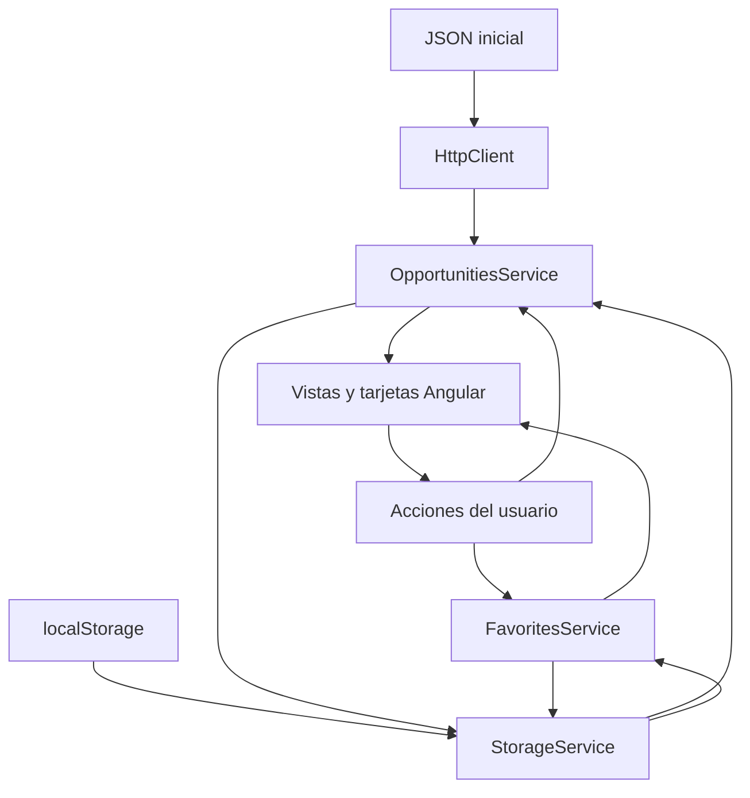

# Radar Útil — Documentación completa de ajustes e implementaciones

**Proyecto:** plataforma de oportunidades para estudiantes y jóvenes.  
**Entrega:** tercera entrega de Desarrollo Front-end.  
**Fecha de la implementación documentada:** 10 de octubre de 2026.  
**Repositorio:** [DevKAlpha/RadarUtil](https://github.com/DevKAlpha/RadarUtil).  
**Sitio publicado:** [Radar Útil](https://devkalpha.github.io/RadarUtil/).

Este documento explica los requisitos solicitados, la solución implementada, los archivos que la contienen y la forma de demostrar su funcionamiento. Su contenido corresponde al código de la migración publicado en `main` y a la configuración final de GitHub Pages. Las rutas de archivos utilizadas en el documento son relativas a la raíz del repositorio.

## Índice

1. [Objetivo y alcance](#1-objetivo-y-alcance)
2. [Migración real a Angular](#2-migración-real-a-angular)
3. [Componentes y responsabilidades](#3-componentes-y-responsabilidades)
4. [Servicios y circulación de los datos](#4-servicios-y-circulación-de-los-datos)
5. [Navegación con Angular Router](#5-navegación-con-angular-router)
6. [Página Inicio](#6-página-inicio)
7. [Página Explorar](#7-página-explorar)
8. [JSON y modelo de oportunidades](#8-json-y-modelo-de-oportunidades)
9. [Vista de detalle](#9-vista-de-detalle)
10. [Favoritos y persistencia](#10-favoritos-y-persistencia)
11. [Formulario de publicación](#11-formulario-de-publicación)
12. [Mini CRUD](#12-mini-crud)
13. [Formulario de contacto](#13-formulario-de-contacto)
14. [Bindings y actualización de la interfaz](#14-bindings-y-actualización-de-la-interfaz)
15. [Conservación del diseño y responsive](#15-conservación-del-diseño-y-responsive)
16. [Organización y documentación del código](#16-organización-y-documentación-del-código)
17. [Configuración de GitHub Pages](#17-configuración-de-github-pages)
18. [Despliegue automático](#18-despliegue-automático)
19. [Instalación, ejecución y comandos](#19-instalación-ejecución-y-comandos)
20. [Verificaciones realizadas](#20-verificaciones-realizadas)
21. [Respaldo, historial, commits y README](#21-respaldo-historial-commits-y-readme)
22. [Correspondencia con todos los requisitos](#22-correspondencia-con-todos-los-requisitos)
23. [Guía de demostración para la sustentación](#23-guía-de-demostración-para-la-sustentación)
24. [Resumen técnico en diez puntos](#24-resumen-técnico-en-diez-puntos)

## 1. Objetivo y alcance

Radar Útil ya contaba con una versión funcional construida con HTML, CSS, JavaScript, JSON y localStorage. La entrega solicitada consistió en evolucionar esa aplicación para demostrar el uso real de Angular, conservando su identidad visual y sus funciones principales.

La migración trasladó la presentación a componentes Angular, la navegación a Angular Router y la lógica de datos a servicios escritos en TypeScript. Las páginas dejaron de depender de archivos HTML independientes y de funciones JavaScript que manipulaban manualmente la interfaz. Ahora Angular representa los datos y responde a las acciones mediante plantillas, bindings, formularios y estado reactivo.

El alcance incluye búsqueda, filtros, detalle, favoritos, publicación local, eliminación local, contacto validado y publicación automática en GitHub Pages. El contacto conserva el carácter de simulación académica y el botón Iniciar sesión muestra un aviso informativo. No se incorporaron autenticación real, registro, backend, base de datos, roles, pagos ni panel administrativo.

La aplicación publicada es estática: GitHub Pages entrega los archivos compilados y la lógica se ejecuta en el navegador. Los datos iniciales proceden de un JSON del proyecto; los datos creados por cada usuario permanecen en su navegador.

## 2. Migración real a Angular

### 2.1. Dependencias y configuración

El proyecto incorpora Angular 21. Los paquetes principales de Angular están fijados en `21.2.25`; Angular CLI y el constructor de compilación están en `21.2.26`. TypeScript utiliza la rama `5.9.3`. Estos valores describen la configuración de la entrega, no una consulta de versiones futuras.

`package.json` define las dependencias y los comandos. `package-lock.json` registra las versiones resueltas para que la instalación del workflow sea reproducible mediante `npm ci`.

`angular.json` declara una aplicación con código fuente en `src/`, entrada en `src/main.ts`, documento inicial en `src/index.html` y salida en `dist/radar-util`. También incluye los recursos de `src/assets/`, el CSS global y la hoja de Bootstrap Icons. La configuración de producción genera nombres de archivos con hash y establece límites de tamaño para detectar aumentos excesivos del paquete inicial.

### 2.2. Arranque de la aplicación

El punto de entrada es [src/main.ts](../src/main.ts). Allí se utiliza `bootstrapApplication` para iniciar `AppComponent` y registrar los servicios de HTTP y navegación:

```typescript
bootstrapApplication(AppComponent, {
  providers: [
    provideHttpClient(),
    provideRouter(
      routes,
      withHashLocation(),
      withInMemoryScrolling({ scrollPositionRestoration: 'enabled' })
    )
  ]
});
```

`provideHttpClient()` permite cargar el JSON. `provideRouter()` registra las rutas. `withHashLocation()` permite abrir y actualizar las vistas en GitHub Pages. La restauración de scroll ayuda a mantener una navegación coherente al volver a una página.

### 2.3. Arquitectura standalone

Los componentes utilizan la arquitectura standalone. Cada componente declara en `imports` las herramientas que necesita, como `RouterLink`, `ReactiveFormsModule` o la tarjeta reutilizable. En la versión utilizada, standalone es el comportamiento predeterminado, por lo que no es necesario escribir `standalone: true` en cada decorador.

Esta organización evita un módulo principal con declaraciones centralizadas. La relación entre una vista y sus dependencias se puede explicar leyendo su propio archivo TypeScript.

### 2.4. Evidencias de uso real

Angular ejecuta la aplicación completa: inicia el componente raíz, representa las páginas, resuelve rutas, carga datos con HttpClient, valida formularios y actualiza las tarjetas mediante bindings. La presencia de Angular se demuestra en el código fuente y en una compilación funcional, no únicamente en la lista de dependencias.

## 3. Componentes y responsabilidades

Se implementaron los nueve componentes mínimos solicitados y un componente raíz que organiza la aplicación.

| Componente | Responsabilidad | Archivo TypeScript |
| --- | --- | --- |
| `AppComponent` | Contiene header, área de rutas, footer y aviso temporal. | `src/app/app.component.ts` |
| `HeaderComponent` | Logo, navegación activa, contador de favoritos y menú móvil. | `src/app/components/header/header.component.ts` |
| `FooterComponent` | Pie de página compartido y enlaces de navegación. | `src/app/components/footer/footer.component.ts` |
| `OpportunityCardComponent` | Presenta una oportunidad y permite acceder a su detalle o cambiar favoritos. | `src/app/components/opportunity-card/opportunity-card.component.ts` |
| `HomeComponent` | Banner, buscador, categorías y oportunidades destacadas. | `src/app/pages/home/home.component.ts` |
| `ExploreComponent` | Búsqueda, categorías, ordenamiento y resultados. | `src/app/pages/explore/explore.component.ts` |
| `DetailComponent` | Consulta por ID y presentación completa de una oportunidad. | `src/app/pages/detail/detail.component.ts` |
| `FavoritesComponent` | Lista las oportunidades guardadas o muestra el estado vacío. | `src/app/pages/favorites/favorites.component.ts` |
| `PublishComponent` | Formulario validado, lectura de imagen y listado de publicaciones propias. | `src/app/pages/publish/publish.component.ts` |
| `ContactComponent` | Formulario de contacto y confirmación de envío simulado. | `src/app/pages/contact/contact.component.ts` |

### 3.1. Componente raíz

`AppComponent` mantiene la estructura compartida alrededor de `RouterOutlet`. Angular inserta dentro de ese outlet la vista correspondiente a la URL. El encabezado y el footer no necesitan repetirse en cada página.

El mismo componente representa el aviso temporal de `NoticeService`. Ese aviso tiene `role="status"` y `aria-live="polite"`, de modo que los cambios pueden anunciarse a tecnologías de asistencia.

### 3.2. Tarjeta reutilizable

`OpportunityCardComponent` recibe una oportunidad mediante un input obligatorio y un modo de presentación:

```typescript
readonly opportunity = input.required<Opportunity>();
readonly mode = input<'home' | 'explore' | 'favorite'>('explore');
```

El modo `home` muestra modalidad, costo y fecha límite. El modo `explore` presenta publicación, cierre y modalidad. El modo `favorite` conserva la distribución de Favoritos y sus acciones “Ver oportunidad” y “Eliminar de favoritos”.

La información procede del mismo modelo en las tres presentaciones. Así se evita duplicar la lógica de favoritos, las rutas de detalle y el formato de fechas.

## 4. Servicios y circulación de los datos

Los servicios separan el manejo de datos de las plantillas. Se registran con `providedIn: 'root'`, por lo que las vistas comparten una instancia de cada servicio durante la ejecución de la aplicación.

### 4.1. OpportunitiesService

[opportunities.service.ts](../src/app/services/opportunities.service.ts) centraliza las oportunidades. Sus responsabilidades son cargar el JSON, leer publicaciones locales, combinar ambos conjuntos, consultar por ID, crear registros propios y eliminarlos.

Mantiene señales para los datos iniciales, las publicaciones locales, el estado de carga y el mensaje de error. Expone `local` como señal de solo lectura y `all` como un valor calculado:

```typescript
readonly all = computed(() => [...this.local(), ...this.base()]);
```

Las publicaciones locales aparecen antes de los datos iniciales en este conjunto combinado. Explorar aplica después el orden seleccionado por fecha. Inicio conserva una selección concreta de seis oportunidades destacadas del catálogo inicial.

### 4.2. FavoritesService

[favorites.service.ts](../src/app/services/favorites.service.ts) centraliza los IDs guardados. Sus métodos `has`, `add`, `remove` y `toggle` permiten consultar, agregar, quitar o alternar el estado de favorito. La misma información alimenta tarjetas, detalle, lista de Favoritos y contador del header.

### 4.3. StorageService

[storage.service.ts](../src/app/services/storage.service.ts) concentra la conversión entre arreglos y texto JSON. `readArray` lee un arreglo o devuelve uno vacío si el contenido no es válido. `writeArray` guarda los datos y devuelve un booleano que indica si la escritura terminó correctamente.

Los servicios actualizan el estado visible después de una escritura exitosa. Si el almacenamiento está bloqueado o sin espacio, se informa mediante un aviso y no se presenta la operación como guardada.

### 4.4. NoticeService

[notice.service.ts](../src/app/services/notice.service.ts) administra mensajes breves para favoritos, publicaciones, errores de almacenamiento y acciones demostrativas. Mantiene el mensaje en una señal y lo retira después de 3,5 segundos. Al recibir un nuevo mensaje, reemplaza el anterior y reinicia ese tiempo.

### 4.5. Flujo general



El archivo JSON aporta el catálogo base. El navegador aporta publicaciones y favoritos. Los servicios entregan ese estado a las vistas y reciben sus acciones. El diagrama resume la circulación de datos; no representa un backend.

## 5. Navegación con Angular Router

Las rutas se encuentran en [app.routes.ts](../src/app/app.routes.ts).

| Ruta lógica | Componente | Ejemplo publicado |
| --- | --- | --- |
| `/` | `HomeComponent` | `/RadarUtil/#/` |
| `/explorar` | `ExploreComponent` | `/RadarUtil/#/explorar` |
| `/detalle/:id` | `DetailComponent` | `/RadarUtil/#/detalle/1` |
| `/favoritos` | `FavoritesComponent` | `/RadarUtil/#/favoritos` |
| `/publicar` | `PublishComponent` | `/RadarUtil/#/publicar` |
| `/contacto` | `ContactComponent` | `/RadarUtil/#/contacto` |

Cada ruta utiliza `loadComponent`, de manera que su vista se carga cuando se necesita. También define un título para la pestaña. El detalle actualiza ese título con el nombre de la oportunidad. Una ruta no reconocida se redirige a Inicio.

Los enlaces internos utilizan `routerLink`, que permite cambiar de vista sin solicitar al servidor un nuevo documento HTML completo. Los enlaces a convocatorias externas conservan un `href` normal.

### 5.1. Enlace activo

El header utiliza `RouterLinkActive` y la clase `active`. La comparación exige la ruta exacta, pero ignora los parámetros de consulta. Por ello, Explorar permanece activo tanto en `/explorar` como en `/explorar?q=excel`.

Cuando se abre `/detalle/:id`, una condición mantiene Explorar resaltado, porque el detalle forma parte de la consulta de oportunidades.

### 5.2. Menú móvil

`menuOpen` controla la apertura del menú. El botón cambia su etiqueta entre “Abrir menú” y “Cerrar menú” y expone `aria-expanded`. Al seleccionar una sección, el menú se cierra. Se conservaron las opciones Inicio, Explorar, Favoritos, Publicar y Contacto.

## 6. Página Inicio

Inicio conserva encabezado, banner, texto principal, botones de explorar y publicar, buscador, categorías, oportunidades destacadas, sección “¿Por qué usar Radar Útil?” y footer.

El banner utiliza el mismo recurso de buena calidad, `src/assets/hero-banner-hd.webp`. El texto principal sigue siendo “Encuentra oportunidades que sí te sirven”. La migración reutiliza la composición visual existente.

### 6.1. Buscador

El campo está conectado a `query` mediante `[(ngModel)]`. Al enviar el formulario, `search()` elimina los espacios exteriores y navega a Explorar con el parámetro `q`:

```typescript
search(): void {
  void this.router.navigate(['/explorar'], {
    queryParams: { q: this.query.trim() || null }
  });
}
```

Una búsqueda de `excel` abre `#/explorar?q=excel`. Explorar interpreta ese valor y presenta las coincidencias.

### 6.2. Categorías y destacados

Las categorías enlazan a Explorar con un parámetro `categoria`. Las oportunidades destacadas se obtienen del servicio mediante `computed`, seleccionando los IDs iniciales del 1 al 6. Su contenido se representa con `@for` y `OpportunityCardComponent`.

La selección de destacados está definida en el componente, pero los títulos, descripciones, imágenes y demás datos proceden del catálogo cargado por Angular. No hay seis tarjetas completas escritas manualmente en el HTML.

## 7. Página Explorar

Explorar conserva el buscador, las categorías, el contador, el selector de orden y la cuadrícula de tarjetas. Su lógica se encuentra en [explore.component.ts](../src/app/pages/explore/explore.component.ts).

### 7.1. Búsqueda

Se consulta el título, la descripción corta y la categoría de cada oportunidad. `normalizeSearch` transforma el texto a minúsculas, elimina tildes y recorta espacios exteriores antes de compararlo.

Por ejemplo, `tecnologia` encuentra oportunidades de `Tecnología`. La búsqueda se realiza por coincidencia de texto y no depende de mayúsculas o acentos.

### 7.2. Filtros

Se mantienen Todas, Educación, Empleo, Tecnología, Eventos y Beneficios. Todas permite ver el conjunto completo. Las demás opciones exigen que la categoría del registro coincida con la seleccionada.

Búsqueda y categoría se combinan: una oportunidad debe cumplir ambas condiciones. El filtro activo cambia de clase visual y expone su estado mediante `aria-pressed`.

### 7.3. Ordenamiento

El selector permite “Más recientes” y “Más antiguas”. Se ordena por `fechaPublicacion`, no por fecha límite. Las fechas del catálogo utilizan `AAAA-MM-DD`, por lo que su comparación textual conserva el orden cronológico.

### 7.4. Actualización reactiva

`query`, `category` y `sort` son señales. `filtered` es un `computed` que depende de ellas y del catálogo del servicio. Cuando cambia cualquiera de esos valores, Angular recalcula el resultado y actualiza las tarjetas y el contador.

```html
<span>{{ filtered().length }} oportunidades encontradas</span>

@for (opportunity of filtered(); track opportunity.id) {
  <app-opportunity-card [opportunity]="opportunity" />
}
```

La búsqueda y la categoría se sincronizan con los parámetros `q` y `categoria` mediante `replaceUrl`, evitando crear una entrada de historial por cada modificación. La selección de orden se mantiene en el estado de la vista; no se guarda en la URL ni en localStorage.

### 7.5. Estados informativos

La vista distingue carga, error de lectura y ausencia de coincidencias. Si no hay resultados, informa que no se encontraron oportunidades con esos filtros. Si el JSON falla, muestra un mensaje que solicita actualizar la página.

## 8. JSON y modelo de oportunidades

### 8.1. Archivo inicial

[oportunidades.json](../src/assets/data/oportunidades.json) contiene 12 oportunidades iniciales. Sus imágenes tienen rutas explícitas relativas a `assets/`.

El servicio realiza una solicitud con HttpClient a `assets/data/oportunidades.json`. Al estar proporcionado en la raíz, carga ese catálogo durante su inicialización y lo comparte entre las vistas de esa ejecución. No vuelve a solicitarlo por cada tarjeta.

El resultado se recibe como `unknown` y se comprueba antes de utilizarlo. Debe ser un arreglo con registros que cumplan la estructura mínima aceptada por `isOpportunity`. Si esa comprobación falla, se muestra el mismo estado de error de carga.

### 8.2. Modelo TypeScript

[opportunity.ts](../src/app/models/opportunity.ts) define `Opportunity`, `PublicationInput`, las categorías y las modalidades.

| Campo | Función |
| --- | --- |
| `id` | Identifica una oportunidad en tarjetas, rutas y favoritos. |
| `titulo` | Nombre visible de la oportunidad. |
| `categoria` | Educación, Empleo, Tecnología, Eventos o Beneficios. |
| `descripcion` | Texto corto para tarjetas y búsqueda. |
| `descripcionCompleta` | Texto principal de la vista de detalle. |
| `modalidad` | Modalidad de participación. |
| `costo` | Información de costo mostrada en la interfaz. |
| `fechaPublicacion` | Fecha utilizada en el ordenamiento. |
| `fechaApertura` | Inicio de la convocatoria. |
| `fechaLimite` | Fecha de cierre. |
| `duracion` | Duración de la oportunidad. |
| `requisitos` | Arreglo de requisitos representados en el detalle. |
| `imagen` | Recurso del catálogo o imagen local convertida a Data URL. |
| `url` | Enlace de la convocatoria o `#` para una convocatoria demostrativa. |
| `etiqueta`, `icono` | Datos opcionales conservados en el modelo. |

`OpportunityId` admite números y cadenas. Esto permite conservar los IDs numéricos del JSON y utilizar IDs de texto para publicaciones locales.

### 8.3. Normalización

La validación de lectura admite ciertos registros de la versión anterior que no tenían todos los campos de presentación. `normalizeOpportunity` completa la descripción completa con la descripción corta cuando falta, utiliza “Por definir” para una duración ausente y asigna una imagen de respaldo si el valor no es admitido.

`safeLink` acepta protocolos HTTP y HTTPS. Un valor que no puede utilizarse como enlace de convocatoria se convierte a `#`. `safeImage` admite recursos locales con el formato previsto y Data URLs de los formatos de imagen permitidos. Estos controles sirven para normalizar los datos utilizados en las plantillas; no equivalen a una validación de servidor.

### 8.4. Diferencia entre catálogo y publicaciones

El JSON forma parte del repositorio y del despliegue. Una publicación creada desde el formulario se agrega a localStorage y al estado Angular, sin escribir en ese archivo. Para modificar permanentemente el catálogo inicial, se edita el JSON del proyecto y se publica un nuevo cambio.

## 9. Vista de detalle

`DetailComponent` lee el parámetro `id` con `ActivatedRoute`. Lo transforma en una señal y utiliza `OpportunitiesService.find()` para localizar el registro dentro del catálogo combinado.

La comparación convierte el ID de cada registro a cadena. Así, la URL `/detalle/1` puede encontrar el ID numérico `1` del JSON y las rutas con `user-...` pueden encontrar publicaciones locales.

La plantilla muestra título, categoría, imagen, descripción, modalidad, costo, fecha de apertura, fecha límite, duración y requisitos. Las fechas se formatean con `OpportunityDatePipe` en español de Colombia, por ejemplo “30 de septiembre de 2026”.

Para conservar un recurso visual del detalle anterior, la oportunidad inicial con ID `1` utiliza `assets/detail-programming.svg` en esa vista. Las demás utilizan su campo `imagen`.

### 9.1. Acciones

El botón “Ir a la convocatoria” utiliza la URL de la oportunidad y abre los enlaces reales en otra pestaña con `rel="noopener noreferrer"`. Cuando el registro tiene `url: "#"`, la acción se intercepta y muestra que la convocatoria es demostrativa.

El botón de favoritos usa el mismo servicio que las tarjetas. Su texto e icono cambian según el registro esté guardado o no, y ese estado también se refleja en el header y en Favoritos.

### 9.2. ID inexistente y carga

Mientras el catálogo está cargando, se muestra “Cargando oportunidad…”. Si al terminar no se encuentra el ID, se presenta “Oportunidad no encontrada” y un enlace para regresar a Explorar. Un error del catálogo se comunica en esa misma área.

## 10. Favoritos y persistencia

### 10.1. Información almacenada

Los favoritos utilizan la clave anterior `radar_util_favoritos`. Su valor es un arreglo JSON de IDs, no una copia completa de las oportunidades:

```json
["1", "3", "user-ejemplo"]
```

El ejemplo ilustra el formato de almacenamiento. Los IDs se normalizan como cadenas y se eliminan duplicados durante la lectura. Al agregar un ID ya guardado, el servicio evita repetirlo.

### 10.2. Construcción de la lista

`FavoritesComponent` calcula `saved` filtrando el catálogo combinado con `favorites.has(item.id)`. Esto permite mostrar oportunidades del JSON y publicaciones locales mediante las mismas tarjetas.

Cuando la lista está vacía se mantiene el mensaje solicitado: “Todavía no tienes oportunidades guardadas. Explora Radar Útil y guarda las que más te interesen.” También permanece el botón “Explorar oportunidades”.

Cuando hay registros, cada tarjeta permite “Ver oportunidad” y “Eliminar de favoritos”. Las acciones cambian el estado del servicio y el contador del header.

### 10.3. Persistencia y pestañas

localStorage permanece al actualizar la página y, en condiciones normales de almacenamiento persistente, al cerrar y abrir el navegador. Al iniciar la aplicación, el servicio recupera los IDs guardados.

El evento `storage` permite leer nuevamente la clave cuando otra pestaña del mismo origen la modifica. La pestaña que realiza la acción actualiza directamente su señal; las demás reciben el evento del navegador.

Los datos pertenecen al origen, perfil y navegador donde se guardaron. El sitio de GitHub Pages y `localhost` tienen almacenamientos distintos. Borrar los datos del sitio o usar un contexto temporal puede eliminar esa persistencia. No se sincronizan datos entre dispositivos.

### 10.4. Lectura y escritura ante errores

Un texto JSON corrupto o un valor que no sea un arreglo se interpreta como un arreglo vacío para evitar que la aplicación deje de funcionar. Si una escritura falla, `StorageService` muestra un mensaje y `FavoritesService` conserva el estado anterior.

## 11. Formulario de publicación

La página Publicar utiliza Reactive Forms. `FormBuilder` crea un grupo de controles no nulos y la plantilla los conecta mediante `[formGroup]` y `formControlName`.

### 11.1. Campos y validaciones

| Campo | Validación implementada |
| --- | --- |
| Título | Obligatorio y con al menos un carácter distinto de espacio. |
| Categoría | Obligatoria y perteneciente a las cinco opciones permitidas. |
| Descripción | Obligatoria y con contenido distinto de espacios. |
| Modalidad | Obligatoria: Virtual, Presencial o Híbrida. |
| Fecha límite | Obligatoria, formato `AAAA-MM-DD` y fecha de calendario válida. |
| Enlace | Obligatorio y con protocolo HTTP o HTTPS. |
| Imagen | Opcional; si se selecciona, debe cumplir formato y tamaño. |

La validación de fecha comprueba que el día exista y que la conversión conserve el valor original. No exige que la fecha sea futura: esa restricción no se incorporó a la entrega.

El enlace no acepta protocolos como `javascript:`. Los validadores están centralizados en [form-validators.ts](../src/app/shared/form-validators.ts), lo que permite reutilizar la validación de texto también en Contacto.

### 11.2. Representación de errores

Al intentar publicar, `markAllAsTouched()` marca todos los controles para mostrar los errores pendientes. Los controles inválidos reciben la clase `invalid` y el atributo `aria-invalid`. El formulario utiliza `novalidate` para presentar los mensajes definidos por Angular.

Si hay controles inválidos, una imagen rechazada o una lectura de imagen pendiente, no se crea la publicación. Se muestra el aviso “Completa los campos obligatorios con datos válidos.”

### 11.3. Imagen opcional

Se admiten PNG, JPG/JPEG, WebP y GIF hasta 2 MB. `FileReader` convierte el archivo elegido a una Data URL para conservarlo junto con el registro local.

Durante la lectura, el botón de publicación se deshabilita. Si el archivo no cumple las condiciones o no puede leerse, se presenta un mensaje. Si no se selecciona imagen, la normalización utiliza `assets/card-tech.svg` como recurso de respaldo.

La imagen permanece en el navegador; no se sube a GitHub ni a un servidor. Como el almacenamiento también contiene la imagen convertida a texto, una escritura puede fallar si se supera la capacidad disponible. Ese fallo se comunica mediante el servicio de almacenamiento.

### 11.4. Creación del registro completo

`OpportunitiesService.create()` genera un ID con el prefijo `user-` y `crypto.randomUUID()`. Recorta título y descripción y completa los campos que el formulario no solicita:

| Campo adicional | Valor utilizado |
| --- | --- |
| `descripcionCompleta` | La descripción ingresada. |
| `costo` | `Gratis`. |
| `fechaPublicacion` | Fecha actual según el navegador. |
| `fechaApertura` | Fecha actual según el navegador. |
| `duracion` | `Por definir`. |
| `requisitos` | `Consultar requisitos en la convocatoria`. |

Estos valores permiten representar una publicación en el mismo detalle del catálogo sin ampliar el formulario solicitado. Son valores de presentación predeterminados; no certifican las condiciones reales de una convocatoria.

Después de guardar correctamente, el servicio actualiza la lista y muestra “Oportunidad publicada correctamente.” El componente limpia el formulario y la selección de imagen. Si el guardado falla, no limpia los datos como si la operación hubiera terminado.

## 12. Mini CRUD

La entrega implementa creación, consulta y eliminación de publicaciones propias. La edición no se incorporó, porque no era obligatoria en el alcance solicitado.

### 12.1. Crear

El usuario completa Publicar. Angular valida los datos y el servicio guarda una oportunidad en `radar_util_publicaciones`. La lista de publicaciones propias se actualiza inmediatamente.

### 12.2. Consultar

Las publicaciones se combinan con el JSON en `OpportunitiesService.all`. Aparecen en Explorar y pueden buscarse, filtrarse, abrirse por ID y guardarse en Favoritos. También se mantienen en el listado de Publicar al actualizar.

### 12.3. Eliminar

El listado de Publicar utiliza `opportunities.local()`, por lo que presenta únicamente publicaciones locales. Su botón llama a `deleteLocal(id)`.

El método comprueba que el ID exista en la colección local, guarda la colección sin ese registro y actualiza el estado. Después intenta retirar su ID de favoritos y muestra “Publicación eliminada.”

Los registros iniciales no forman parte de esa colección y no se eliminan mediante este procedimiento. Tampoco se modifica el JSON del repositorio. Si falla la escritura de publicaciones, se conserva la lista anterior. La limpieza de favoritos realiza su propia escritura; si esta falla, su aviso informa el problema, y la vista de Favoritos sigue mostrando únicamente IDs que correspondan a oportunidades existentes.

### 12.4. Alcance local

Una publicación creada en un navegador no se vuelve visible para otros visitantes. La demostración del mini CRUD corresponde a la gestión de datos en el navegador, que era la solución solicitada al no existir backend.

## 13. Formulario de contacto

`ContactComponent` conserva los campos Nombre, Correo electrónico, Asunto y Mensaje. Utiliza un formulario reactivo con validación de campos obligatorios, rechazo de textos formados solo por espacios y `Validators.email` para el correo.

Al enviar, se marcan los controles como tocados. Si el formulario es inválido, conserva su estado y presenta los errores de cada campo. Si es válido, la señal `sent` cambia a `true`.

La plantilla utiliza `@if` para reemplazar el formulario por la confirmación:

> Tu mensaje fue enviado correctamente.

También muestra un enlace para regresar a Inicio. Se conserva el diseño de confirmación existente.

El envío es una simulación académica: no realiza una solicitud a un servicio de correo, no envía un email y no guarda el mensaje en una base de datos. El estado de confirmación pertenece a esa instancia de la vista y se reinicia al volver a crear el componente o actualizar la página.

## 14. Bindings y actualización de la interfaz

Los bindings relacionan el estado TypeScript con la plantilla. Los ejemplos siguientes corresponden a usos presentes en el proyecto.

### 14.1. Interpolación

```html
<h3>{{ opportunity().titulo }}</h3>
```

La interpolación representa texto a partir de una expresión. Se utiliza en títulos, descripciones, fechas, contador de resultados y mensajes. El título cambia según la oportunidad recibida por la tarjeta.

### 14.2. Property binding

```html

<a [routerLink]="['/detalle', opportunity().id]">Ver más</a>
```

Los corchetes asignan valores calculados a propiedades de elementos o directivas. Aquí permiten utilizar la imagen del registro y construir la ruta de su detalle. También se usan para pasar `[opportunity]` a una tarjeta y deshabilitar el botón durante la lectura de una imagen.

### 14.3. Event binding

```html
<button (click)="favorites.toggle(opportunity().id)">Guardar</button>
```

Los paréntesis conectan un evento con un método. Se utilizan en favoritos, filtros, eliminación, menú móvil y lectura de archivos. Los formularios conectan `(ngSubmit)` con el método que valida o procesa el envío.

### 14.4. Two-way binding

```html
<input name="query" [(ngModel)]="query">
<select name="sort" [(ngModel)]="sort">...</select>
```

`[(ngModel)]` mantiene sincronizados el control y el estado del componente. Inicio lo utiliza en su búsqueda; Explorar lo utiliza en búsqueda y ordenamiento. En Explorar, ese estado se representa mediante señales.

### 14.5. Formularios reactivos, clases y atributos

```html
<form [formGroup]="form" (ngSubmit)="submit()">
  <input formControlName="titulo" [class.invalid]="invalid('titulo')">
</form>
```

`[formGroup]` conecta la plantilla con el grupo creado en TypeScript. `formControlName` identifica un control. `[class.invalid]` relaciona su presentación con el resultado de validación.

El proyecto utiliza además `[class.active]`, `[attr.aria-pressed]`, `[attr.aria-expanded]` y `[attr.aria-invalid]` para expresar estados visuales y accesibles.

### 14.6. Bloques de control y señales

`@for` representa colecciones de oportunidades y requisitos. `track opportunity.id` permite identificar cada tarjeta de manera estable. `@if` controla estados de carga, errores, ausencia de resultados, favoritos vacíos y confirmación de contacto.

Las señales contienen estado que Angular puede observar. `computed` deriva listas y resultados de otras señales. Así, agregar un favorito o crear una publicación actualiza las vistas relacionadas sin reconstruir manualmente el HTML.

## 15. Conservación del diseño y responsive

### 15.1. Recursos preservados

La migración conserva logo, favicon, banner, imágenes utilizadas, tipografía Inter, colores, iconos, tarjetas, encabezado, footer y distribución general. Los archivos visuales utilizados se trasladaron a `src/assets/`.

Bootstrap Icons se incorpora desde la dependencia local. La fuente Inter mantiene su importación desde Google Fonts en `src/styles.css`. No se añadió un sistema visual distinto ni un dashboard.

### 15.2. Adaptación del CSS

El CSS anterior se reutiliza en [src/styles.css](../src/styles.css). Los ajustes permiten que los elementos personalizados de Angular participen correctamente en la distribución, evitan problemas de ancho y conservan la altura de las tarjetas.

También se ajustaron áreas de detalle y publicaciones para que los textos y acciones se distribuyan en pantallas pequeñas. Los estilos locales de la tarjeta tienen un alcance reducido a su host y a la altura del artículo.

### 15.3. Pantallas pequeñas

Los puntos de adaptación principales del CSS están en 980 px y 640 px. El menú cambia a una presentación desplegable, las cuadrículas reducen sus columnas, las áreas de detalle pasan a una columna y el formulario de publicación se reorganiza.

Se verificó la aplicación en escritorio de 1440 × 1000, tablet de 768 × 1024 y móvil de 390 × 844. Las pruebas comprueban la ausencia de desbordamiento horizontal y la carga de imágenes durante la navegación.

### 15.4. Accesibilidad incorporada

Los controles mantienen etiquetas asociadas, las imágenes tienen textos alternativos y los iconos decorativos utilizan `aria-hidden`. El menú y los filtros comunican su estado; los campos informan si son inválidos; los mensajes de carga y error tienen roles adecuados.

Estas mejoras acompañan las funciones solicitadas. Las verificaciones descritas no constituyen una auditoría completa de conformidad de accesibilidad.

## 16. Organización y documentación del código

### 16.1. Estructura final

```text
RadarUtil/
├── .github/
│   └── workflows/
│       └── deploy.yml
├── docs/
│   ├── RESUMEN_TECNICO.md
│   └── DOCUMENTACION_COMPLETA.md
├── scripts/
│   └── serve-build.mjs
├── src/
│   ├── app/
│   │   ├── components/
│   │   │   ├── header/
│   │   │   ├── footer/
│   │   │   └── opportunity-card/
│   │   ├── pages/
│   │   │   ├── home/
│   │   │   ├── explore/
│   │   │   ├── detail/
│   │   │   ├── favorites/
│   │   │   ├── publish/
│   │   │   └── contact/
│   │   ├── services/
│   │   │   ├── opportunities.service.ts
│   │   │   ├── favorites.service.ts
│   │   │   ├── storage.service.ts
│   │   │   └── notice.service.ts
│   │   ├── models/
│   │   │   └── opportunity.ts
│   │   ├── shared/
│   │   │   ├── form-validators.ts
│   │   │   └── opportunity-date.pipe.ts
│   │   ├── app.component.ts
│   │   └── app.routes.ts
│   ├── assets/
│   │   ├── data/oportunidades.json
│   │   ├── logo.svg
│   │   ├── favicon.svg
│   │   ├── hero-banner-hd.webp
│   │   └── imágenes de tarjetas y detalle
│   ├── index.html
│   ├── main.ts
│   └── styles.css
├── tests/
│   └── application.spec.mjs
├── angular.json
├── package.json
├── package-lock.json
├── playwright.config.mjs
├── tsconfig.json
├── tsconfig.app.json
└── README.md
```

`components/` agrupa piezas reutilizables; `pages/`, vistas asociadas a rutas; `services/`, estado y operaciones; `models/`, contratos de datos; y `shared/`, validadores y formato de fechas. Cada página conserva su archivo de lógica y su plantilla HTML.

`scripts/serve-build.mjs` es una herramienta de desarrollo para servir la compilación estática durante las pruebas locales. No forma parte de un backend del producto ni procesa publicaciones de los usuarios. Los archivos `.mjs` de pruebas y configuración cumplen funciones de soporte; la lógica de la aplicación está dentro de Angular.

### 16.2. TypeScript estricto

`tsconfig.json` activa comprobaciones estrictas del lenguaje y de las plantillas Angular. Esto permite detectar incompatibilidades de tipos, accesos incorrectos a propiedades y errores en las expresiones de las plantillas durante la compilación.

El modelo compartido evita que cada componente defina una versión diferente de una oportunidad. Los validadores y el pipe de fechas también se reutilizan.

### 16.3. Comentarios y limpieza

Los comentarios se concentran en decisiones que necesitan contexto, como la estrategia hash, la resolución del JSON respecto al base href, la compatibilidad con datos anteriores, la sincronización entre pestañas y la eliminación exclusiva de registros locales.

Los archivos antiguos que dejaron de utilizarse se retiraron del árbol actual. La versión anterior permanece en el historial y en el respaldo Git local. El código y los comentarios mantienen lenguaje técnico orientado al proyecto.

## 17. Configuración de GitHub Pages

### 17.1. Subdirectorio y base href

La aplicación se publica bajo `/RadarUtil/`. Por eso el comando de Pages es:

```bash
npm run build:pages
```

Ese script ejecuta `ng build --base-href /RadarUtil/`. El documento compilado utiliza ese prefijo para resolver los archivos JavaScript, CSS y recursos relativos. El JSON se solicita entonces dentro de `/RadarUtil/assets/data/`.

El archivo fuente `src/index.html` conserva `<base href="/">` para el entorno local. El parámetro de compilación sustituye el valor en la salida destinada a Pages.

### 17.2. Rutas hash

Una URL interna publicada tiene el formato:

```text
https://devkalpha.github.io/RadarUtil/#/detalle/1
```

El navegador solicita al servidor la parte anterior al `#`. Angular interpreta el fragmento para mostrar la vista. Así, actualizar una ruta interna no exige que GitHub Pages tenga un archivo físico llamado `detalle/1`.

Esta estrategia resuelve la navegación directa y la actualización de vistas en el alojamiento estático solicitado.

### 17.3. Favicon y recursos

`src/index.html` define idioma español, viewport para dispositivos móviles y favicon SVG relativo a `assets/`. `angular.json` copia los recursos al resultado de la compilación. La salida publicada se encuentra en `dist/radar-util/browser/`.

La configuración del repositorio quedó con **Settings → Pages → Source → GitHub Actions**. Esa elección utiliza el workflow Angular como fuente de publicación.

## 18. Despliegue automático

El archivo [deploy.yml](../.github/workflows/deploy.yml) define el workflow “Publica Radar Útil”. Se ejecuta cuando se publica un cambio en `main` y también admite ejecución manual con `workflow_dispatch`.

### 18.1. Trabajo de compilación

El trabajo `build` realiza estos pasos:

1. Obtiene el repositorio mediante `actions/checkout@v6`.
2. Configura Node.js 24 con `actions/setup-node@v6` y caché de npm.
3. Instala las dependencias exactas con `npm ci`.
4. Compila Angular mediante `npm run build:pages`.
5. Configura el contexto de Pages con `actions/configure-pages@v5`.
6. Prepara `dist/radar-util/browser` como artefacto con `actions/upload-pages-artifact@v4`.

### 18.2. Trabajo de publicación

`deploy` depende de `build`, por lo que se ejecuta cuando la compilación termina correctamente. Utiliza `actions/deploy-pages@v4` para publicar el artefacto en el entorno `github-pages`.

El workflow tiene lectura del repositorio; el trabajo de publicación dispone de `pages: write` e `id-token: write`. La configuración usa los mecanismos de Actions para desplegar y no contiene credenciales escritas en el código.

La concurrencia utiliza el grupo `github-pages` y cancela una ejecución anterior que siga en curso cuando comienza una más reciente. Así se evita que se publique una versión anterior después de un nuevo cambio.

### 18.3. Resultado comprobado

El [despliegue final de la migración](https://github.com/DevKAlpha/RadarUtil/actions/runs/38079027692) terminó correctamente para el commit `fb138c5`. Ese cambio ejecutó únicamente el workflow “Publica Radar Útil”, después de configurar Pages como GitHub Actions.

El proceso no utiliza Python. Después de publicar un cambio válido en `main`, no requiere repetir pasos manuales de instalación, compilación o carga del sitio. El workflow actual instala, compila y despliega; las pruebas Playwright se ejecutan por separado y no forman parte de ese workflow.

## 19. Instalación, ejecución y comandos

### 19.1. Entorno

`package.json` declara compatibilidad con Node.js `^22.12.0` o `^24.0.0`. El entorno de la migración utilizó Node.js 24.14.1 y npm 11.11. El workflow utiliza Node.js 24.

### 19.2. Ejecución local

Desde la raíz del proyecto:

```bash
npm install
npm start
```

`npm start` ejecuta `ng serve`. La aplicación puede abrirse en `http://localhost:4200/`, con rutas como `http://localhost:4200/#/explorar`.

### 19.3. Compilación

```bash
npm run build
```

Compila utilizando la base local `/`.

```bash
npm run build:pages
```

Compila utilizando `/RadarUtil/` para el despliegue publicado. En ambos casos se utiliza la configuración de producción por defecto.

### 19.4. Pruebas locales

```bash
npm run build:pages
npm run test:e2e
```

La configuración de Playwright utiliza Microsoft Edge con `channel: 'msedge'`. El equipo debe tener ese navegador disponible. `scripts/serve-build.mjs` sirve la compilación en `http://127.0.0.1:4173/RadarUtil/` durante las pruebas.

### 19.5. Pruebas del sitio publicado en PowerShell

```powershell
$env:RADAR_BASE_URL = 'https://devkalpha.github.io/RadarUtil/'
npm run test:e2e
Remove-Item Env:\RADAR_BASE_URL
```

Cuando está definida `RADAR_BASE_URL`, las pruebas utilizan esa dirección y no levantan el servidor estático local. El último comando retira la variable de esa sesión para volver al comportamiento local.

Las pruebas crean contextos de navegador con datos propios de prueba. Las publicaciones creadas durante ellas se guardan en esos contextos; no alteran el JSON publicado.

## 20. Verificaciones realizadas

### 20.1. Instalación y compilación

Durante la migración se verificó `npm install` sin errores ni vulnerabilidades reportadas y `npm run build:pages` sin errores ni warnings. El workflow final también completó instalación, compilación y publicación correctamente.

Estos resultados corresponden al momento de la entrega. No son una garantía sobre dependencias o condiciones que puedan cambiar posteriormente.

### 20.2. Pruebas de navegador

[application.spec.mjs](../tests/application.spec.mjs) define seis escenarios. [playwright.config.mjs](../playwright.config.mjs) los ejecuta en tres tamaños de pantalla: escritorio, tablet y móvil. El resultado es **18 ejecuciones aprobadas** en local y **18 ejecuciones aprobadas** contra el sitio público durante la verificación de la migración.

| Escenario | Comprobaciones principales |
| --- | --- |
| Inicio, navegación y responsive | Texto principal, seis destacados, banner original, navegación activa, carga de imágenes, favicon, JSON, base href y ausencia de desbordamiento horizontal. |
| Búsqueda, filtros y orden | Búsqueda desde Inicio, coincidencias en Explorar, categorías, contador, orden por fecha, búsqueda sin tilde, estado sin resultados y actualización sin recarga del documento. |
| Detalle y favoritos | Detalle por ID, requisitos y datos, aviso de convocatoria demostrativa, favorito tras actualizar, recuperación del almacenamiento en un contexto nuevo, eliminación y estado vacío, ID inexistente. |
| Publicación y eliminación | Campos obligatorios, rechazo de enlace inválido, imagen, creación, persistencia tras actualizar, aparición en Explorar y detalle, favorito y eliminación exclusiva del registro local. |
| Contacto | Campos obligatorios, nombre formado por espacios, correo inválido y confirmación con datos válidos. |
| Datos corruptos y carga fallida | Recuperación ante contenido inválido de localStorage y presentación del error ante una respuesta HTTP 503 del JSON. |

La prueba de favoritos utiliza `storageState` para trasladar el almacenamiento a un contexto nuevo. Eso comprueba la recuperación desde estado persistido; no automatiza el cierre y reinicio físico del navegador del usuario.

El escenario de navegación registra errores JavaScript y mensajes de consola de tipo error o warning y comprueba que la navegación normal no los produzca. Las pruebas generan capturas de las vistas para revisar su presentación.

### 20.3. Límites de la evidencia

Los resultados cubren los escenarios y tamaños indicados. No se realizaron en esta entrega una auditoría completa de seguridad, una auditoría de accesibilidad, una prueba de todos los navegadores o una prueba de carga. El manejo de escrituras fallidas y sincronización entre pestañas está implementado; los seis escenarios automatizados no comprueban por separado cada variante de esos casos.

La creación de este documento amplía la explicación de la entrega. No modifica el comportamiento de la aplicación ni representa una nueva ejecución de las pruebas funcionales.

## 21. Respaldo, historial, commits y README

### 21.1. Respaldo previo

Antes de reemplazar la versión funcional se creó el punto de respaldo Git local `respaldo-pre-angular-2026-10-10`, que conserva el estado previo en el commit `a36fe59`. El historial existente no se borró.

También existe la etiqueta local `respaldo-angular-local-2026-10-10`, que conserva un estado intermedio de la migración local. Estas etiquetas son respaldos del repositorio local; no se presentan como etiquetas publicadas en GitHub.

### 21.2. Cambios publicados

Los cambios finales de la migración quedaron en `main` mediante commits con mensajes orientados al proyecto:

| Commit | Mensaje |
| --- | --- |
| `38185a2` | Integra Angular y conserva la interfaz |
| `03aea0d` | Documenta verificación del proyecto |
| `fb138c5` | Documenta Pages configurado con GitHub Actions |

El último commit indicado corresponde a la migración y su configuración final, antes de la redacción de este documento ampliado.

### 21.3. README y documentación

[README.md](../README.md) explica nombre y propósito, tecnologías, ejecución local, compilación, pruebas, estructura, funcionamiento, almacenamiento y enlace publicado. Se mantiene como punto de entrada breve al proyecto.

[RESUMEN_TECNICO.md](RESUMEN_TECNICO.md) contiene los diez puntos solicitados para la sustentación. Este documento amplía cada requisito y aporta referencias a los archivos donde se puede demostrar.

## 22. Correspondencia con todos los requisitos

La siguiente tabla relaciona los 22 apartados del encargo original con la solución entregada.

| Requisito original | Ajuste o implementación | Explicación en este documento |
| --- | --- | --- |
| 1. Angular real | Arranque Angular, standalone, HTTP, Router, Forms, bindings y compilación. | Secciones 2 y 14. |
| 2. Componentes mínimos | Nueve componentes solicitados y `AppComponent`. | Sección 3. |
| 3. Navegación | Seis rutas, enlaces internos, estado activo y menú móvil. | Sección 5. |
| 4. Inicio | Banner y contenido conservados; destacados dinámicos. | Sección 6. |
| 5. Explorar | Búsqueda, cinco categorías, Todas, fecha y contador reactivo. | Sección 7. |
| 6. JSON | Catálogo de 12 registros cargado con HttpClient y modelo TypeScript. | Sección 8. |
| 7. Detalle | Consulta por ID, información completa y acciones. | Sección 9. |
| 8. Favoritos | Servicio compartido, localStorage, estado vacío y eliminación. | Sección 10. |
| 9. Publicación | Reactive Forms, validación, imagen opcional y almacenamiento local. | Sección 11. |
| 10. Mini CRUD | Crear, consultar y eliminar únicamente registros locales. | Sección 12. |
| 11. Contacto | Campos y correo validados; confirmación simulada. | Sección 13. |
| 12. Diseño | CSS y recursos existentes conservados; comprobación responsive. | Sección 15. |
| 13. Organización | Componentes, páginas, servicios, modelos, shared y assets. | Sección 16. |
| 14. Comentarios | Comentarios limitados a decisiones de implementación. | Sección 16. |
| 15. Pages | Base `/RadarUtil/`, rutas hash, favicon y recursos relativos. | Sección 17. |
| 16. Automatización | Instalación, compilación y despliegue en cada push a `main`. | Sección 18. |
| 17. Verificaciones | Instalación, build, pruebas locales y públicas, consola y responsive. | Sección 20. |
| 18. README | Información de ejecución, estructura, tecnologías y URL. | Sección 21. |
| 19. Repositorio | Trabajo sobre el repositorio existente, respaldo y conservación del historial. | Sección 21. |
| 20. Commits | Mensajes breves que describen los cambios. | Sección 21. |
| 21. Alcance limitado | Funciones académicas, sin backend, login real ni funcionalidades ajenas. | Secciones 1, 12 y 13. |
| 22. Resultado y resumen | Aplicación Angular publicada y documentación para demostrar cada función. | Secciones 23 y 24. |

## 23. Guía de demostración para la sustentación

### Paso 1. Presentar la continuidad visual

Abre [Inicio](https://devkalpha.github.io/RadarUtil/#/) y explica que se conservan banner, logo, colores, textos, tarjetas y distribución. El cambio principal está en la arquitectura y el manejo de la interfaz.

### Paso 2. Mostrar el arranque y los componentes

Abre `src/main.ts`, `app.component.ts` y una página. Señala `bootstrapApplication`, los providers y el `RouterOutlet`. Muestra que la tarjeta recibe una oportunidad y que varias vistas reutilizan ese componente.

### Paso 3. Demostrar las rutas

Navega por las cinco opciones del header y abre un detalle. Relaciona las URLs con `app.routes.ts`. Actualiza una vista interna para demostrar que la estrategia hash funciona en Pages.

### Paso 4. Mostrar el origen de los datos

Abre `src/assets/data/oportunidades.json` y `OpportunitiesService`. Explica la solicitud HTTP, la validación del arreglo y la combinación con publicaciones locales. Muestra un `@for` para explicar que Angular genera las tarjetas desde datos.

### Paso 5. Demostrar búsqueda y filtros

Busca `excel` desde Inicio. En Explorar, limpia la búsqueda, selecciona una categoría y cambia el orden por fecha. Muestra el contador. Explica que `computed` deriva el listado del estado actual sin recargar el documento.

### Paso 6. Demostrar detalle y favoritos

Abre una oportunidad, revisa sus datos y guárdala. Entra a Favoritos y actualiza la página. Explica la clave `radar_util_favoritos`, los IDs guardados y la consulta del catálogo. Retira el favorito para mostrar el estado vacío.

### Paso 7. Demostrar validación y creación

Intenta enviar Publicar vacío para mostrar errores. Completa los campos con un enlace HTTP/HTTPS válido y, si lo deseas, una imagen permitida. Publica y verifica que el registro aparezca en Publicar y Explorar después de actualizar.

### Paso 8. Demostrar eliminación local

Abre el detalle del registro creado. Regresa a Publicar y elimínalo. Explica que el servicio modifica exclusivamente `radar_util_publicaciones` y que las 12 oportunidades iniciales siguen disponibles.

### Paso 9. Demostrar Contacto

Intenta enviar sin datos o con un correo incorrecto. Después completa los campos correctamente y muestra la confirmación. Aclara que la validación es real y el envío es una simulación académica.

### Paso 10. Demostrar la publicación automática

Abre `.github/workflows/deploy.yml` y el enlace de la ejecución final. Explica los trabajos `build` y `deploy`, el base href y la fuente GitHub Actions. Cierra la demostración mostrando el sitio publicado y los resultados de las verificaciones.

## 24. Resumen técnico en diez puntos

1. **Componentes creados:** `HeaderComponent`, `FooterComponent`, `OpportunityCardComponent`, `HomeComponent`, `ExploreComponent`, `DetailComponent`, `FavoritesComponent`, `PublishComponent` y `ContactComponent`, coordinados por `AppComponent`. La arquitectura es standalone.
2. **Servicios creados:** `OpportunitiesService` administra catálogo y publicaciones; `FavoritesService`, IDs guardados; `StorageService`, lectura y escritura local; y `NoticeService`, avisos temporales.
3. **Rutas implementadas:** `/`, `/explorar`, `/detalle/:id`, `/favoritos`, `/publicar` y `/contacto`, con carga diferida, títulos y estrategia hash para Pages.
4. **Bindings utilizados:** interpolación en textos y contador; property binding en imágenes, rutas e inputs; event binding en acciones; two-way binding en búsqueda y orden; formularios reactivos en Publicar y Contacto; bindings de clases y atributos para estados.
5. **localStorage:** `radar_util_favoritos` almacena IDs y `radar_util_publicaciones` almacena oportunidades propias. Los servicios recuperan los datos al iniciar y sincronizan cambios entre pestañas del mismo origen.
6. **JSON:** `src/assets/data/oportunidades.json` contiene 12 registros iniciales. HttpClient los carga y el servicio valida y normaliza los datos antes de representarlos.
7. **Mini CRUD:** el formulario crea registros locales, Explorar y Detalle permiten consultarlos y Publicar permite eliminarlos. La eliminación no modifica el JSON inicial. La edición queda fuera de esta entrega.
8. **Estructura final:** `components/`, `pages/`, `services/`, `models/` y `shared/` dentro de `src/app/`; recursos en `src/assets/`; pruebas en `tests/`; documentación en `docs/`; workflow en `.github/workflows/`.
9. **Archivos principales:** configuración npm, Angular y TypeScript; `src/main.ts`; componente raíz y rutas; componentes, plantillas y servicios; modelo y validadores; JSON, CSS y favicon; workflow; pruebas; README y documentos técnicos.
10. **URL final:** [https://devkalpha.github.io/RadarUtil/](https://devkalpha.github.io/RadarUtil/). El despliegue utiliza GitHub Actions y la migración se verificó con compilación correcta y 18 ejecuciones de pruebas en tres tamaños, tanto localmente como contra el sitio público.
