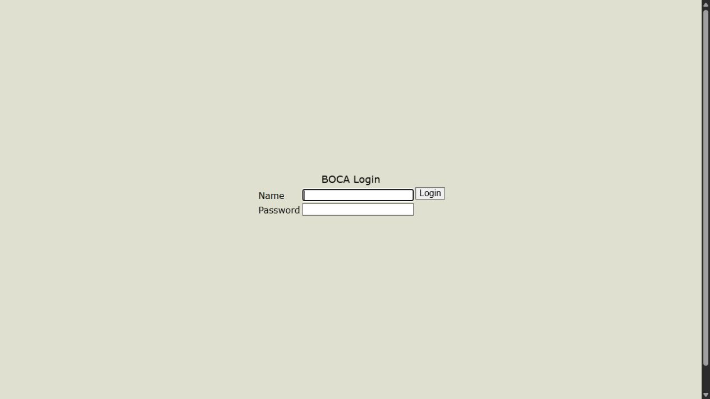
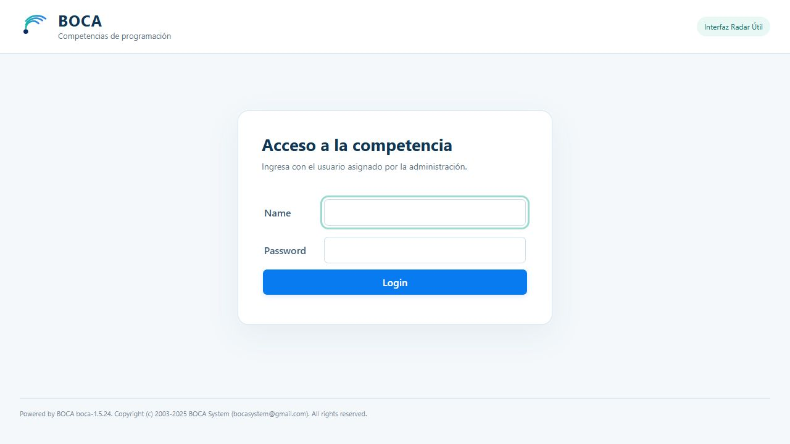

# Evidencias reales de BOCA

Las imágenes se capturaron desde el navegador conectado a los servidores PHP reales. No son ilustraciones generadas ni reconstrucciones de la interfaz. El original y la versión personalizada comparten código de BOCA y base de datos; el servidor original no recibe el tema. Los PNG son conversiones sin cambios de contenido de las capturas del navegador.

## Antes y después

| Archivo | Pantalla | URL de captura |
|---|---|---|
| `01-login-original.png` | Login original de BOCA | `http://localhost:8089/boca/` |
| `02-login-mejorado.png` | Login con la interfaz final | `http://localhost:8088/boca/` |
| `03-competencia-original.png` | Configuración original de competencia | `http://localhost:8089/boca/system/contest.php` |
| `04-competencia-mejorada.png` | Mismo formulario y datos con el tema | `http://localhost:8088/boca/system/contest.php` |
| `05-usuarios-originales.png` | Usuarios originales | `http://localhost:8089/boca/admin/user.php` |
| `06-usuarios-mejorados.png` | Mismos usuarios con la nueva presentación | `http://localhost:8088/boca/admin/user.php` |

La pareja de competencias corresponde a la primera competencia de demostración y las capturas de usuarios a la competencia 10. Se conservan para comparar los mismos datos antes/después. Las horas y fechas de acceso pueden diferir por el tiempo transcurrido entre capturas.

## Páginas funcionales

| Archivo | Evidencia |
|---|---|
| `07-problema-cargado.png` | Paquete oficial bits.zip y metadatos almacenados en la competencia 10. |
| `08-envio-evaluado.png` | Envío 683889201, competencia 10, evaluado manualmente y consultado por administración. |
| `09-resultados.png` | Clasificación real calculada a partir de la evaluación manual de esa competencia. |
| `10-equipo-envios.png` | Equipo autenticado, envío 689752901 y selector que incluye el problema A en la competencia 11. |
| `11-equipo-movil.png` | Vista real de equipo a 390 × 844 px con tabla desplazable. |
| `12-juez-envios.png` | Juez autenticado consultando el envío y su respuesta en la competencia 11. |

Las capturas muestran contenido de la pestaña, sin añadir una barra de dirección artificial. Las URLs de origen se registran aquí y en el reporte del navegador. El resultado `YES` fue registrado mediante evaluación manual; no evidencia ejecución automática del código.

## Reportes de comprobación

| Archivo | Contenido |
|---|---|
| `PRUEBAS_FUNCIONALES.json` | 15 comprobaciones HTTP reales en el servidor final de puerto 8088; competencia 11, envío 689752901. |
| `PRUEBAS_INSTALACION_LIMPIA.json` | Las mismas 15 comprobaciones sobre volúmenes nuevos, puerto 8090; competencia 1, envío 690386101. |
| `PRUEBA_NAVEGADOR.json` | URL, ancho de pantalla y documento, opciones del selector, medidas de la tabla y consola sin errores en la prueba móvil. |
| `FORMULARIOS_ORIGINALES.json` | Nombres, tipos, identificadores, acciones, métodos y eventos del formulario original de usuarios, sin valores. |
| `FORMULARIOS_MEJORADOS.json` | La misma firma del formulario tras aplicar el tema; igualdad comprobada. |
| `VERIFICACIONES_ADICIONALES.json` | Resultado de integridad, comparación de formularios, reinicio y persistencia. |

Fechas de los reportes en UTC. La prueba principal y la limpia son instalaciones independientes, por lo que sus identificadores no coinciden. Los archivos temporales, cookies, contraseñas y `.env` no se incluyen.
